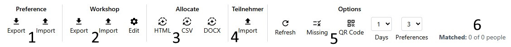
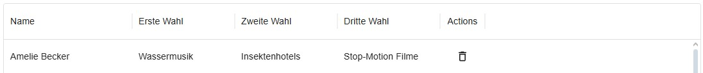
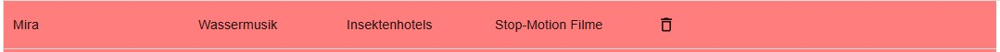
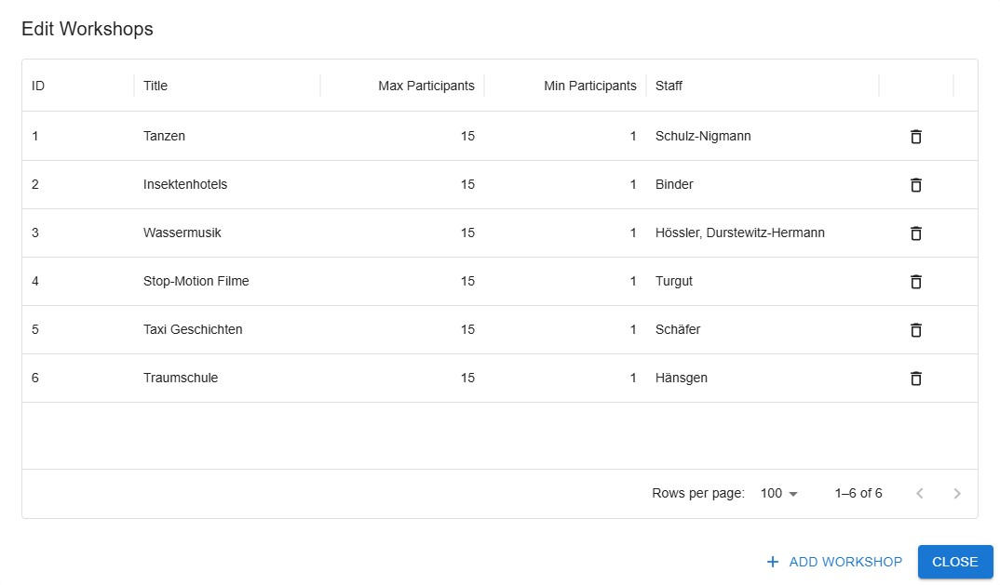
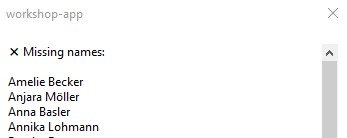
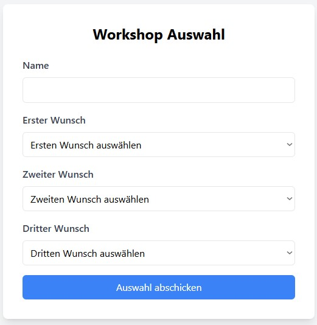

---
pdf_options:
  format: A4
  margin: 30mm 20mm
  printBackground: true
  headerTemplate: |-
    <style>
      section {
        margin: 0 auto;
        font-family: system-ui;
        font-size: 11px;
      }
    </style>
    <section>
      <span class="date"></span>
    </section>
  footerTemplate: |-
    <section>
      <div>
        Page <span class="pageNumber"></span>
        of <span class="totalPages"></span>
      </div>
    </section>
---

# Handbuch Semera Workshop

---

## Menü-Übersicht



1. **Preferences (Präferenzen-Verwaltung)**  
2. **Workshop-Verwaltung**  
3. **Zuteilung (Allocation)**  
4. **Teilnehmer-Verwaltung**  
5. **Optionen**  
6. **Statusanzeige (Matched Count)**  

---

Vor der ersten Benutzung bitte die Workshops hinzufügen und eine Teilnehmenden Liste importieren!

### 1. Preferences (Präferenzen-Verwaltung)

Hier können die **Workshop-Wahlen** der Teilnehmenden eingesehen, bearbeitet und verwaltet werden.

* **Export**  
  → Exportiert alle Workshop-Wahlen im **.json-Format**.

* **Import**  
  → Importiert Workshop-Wahlen im **.json-Format**.  

📂 **Beispiel-Datei (`preferences.json`):**
```json
[
  {
    "id": 1,
    "name": "Max Mustermann",
    "preferences": {
      "first": "Workshop A",
      "second": "Workshop B",
      "third": "Workshop C"
    }
  },
  {
    "id": 2,
    "name": "Erika Musterfrau",
    "preferences": {
      "first": "Workshop B",
      "second": "Workshop A",
      "third": "Workshop D"
    }
  }
]
```

* **Tabelle**  


  * Spalten: **Name, Erste Wahl – Fünfte Wahl, Aktionen**  
  * In der **Aktionsspalte** können Einträge gelöscht werden.  
  * **Rote Markierung:** Falls kein Teilnehmer gefunden wird (z. B. Tippfehler).  
  

* **Bearbeiten per Doppelklick**  
  → Name oder eine Wahl doppelt anklicken → direkt editierbar.  
  → Änderungen werden **automatisch gespeichert**.
  → Es ist wichtig, hier bei dem Namen und der Präferenz den exakten Inhalt anzugeben. Auf Gross und Kleinschreibung sowie Sonderzeichen (auch Leerzeichen) muss gesondert geachtet werden.

* **Zeilen löschen**  
  → Besonders sinnvoll, wenn es **Doppel-Einträge** gibt.  
  → ACHTUNG: Vor dem Löschen gibt es kein Warnung!

---

### 2. Workshop (Workshops verwalten)

* **Export**  
  → Exportiert alle Workshops als **.json**.  

* **Import**  
  → Importiert Workshops aus einer **.json-Datei**.  

📂 **Beispiel-Datei (`workshops.json`):**
```json
[
  {
    "id": 1,
    "title": "Workshop A",
    "maxParticipants": 20,
    "minParticipants": 5,
    "staff": "Herr Schmidt"
  },
  {
    "id": 2,
    "title": "Workshop B",
    "maxParticipants": 15,
    "minParticipants": 5,
    "staff": "Frau Müller"
  }
]
```

* **Edit**  
  → Öffnet eine neue Ansicht zur Bearbeitung der Workshops.  



* **Add Workshop**  
  → Fügt einen neuen Workshop hinzu.  

* **Eigenschaften bearbeiten**  
  * Name  
  * Maximale Teilnehmerzahl  
  * Minimale Teilnehmerzahl  
  * Veranstaltende Person (**staff**)  
  * Aktionsspalte

* **Mülleimer-Button**  
  → Löscht einen Workshop.  
  → ACHTUNG: Vor dem Löschen gibt es kein Warnung!

---

### 3. Zuteilung

Jedes mal, wenn einer der Knöpfe gedrückt wird, wird eine neue Zuteilung generiert. Erstellt man also eine Zuteilung als CSV und danach als DOCX, unterscheiden sich diese Zuteilungen.
Falls eine Person nicht zu einem Workshop zugewiesen werden kann, wird dies NICHT mitgeteilt.
Bitte nach der Zuteilung prüfen, dass alle Personen eine Zuteilung erhalten haben!

* **HTML**  
  → Erstellt eine **Zuteilung** als HTML-Datei.  

* **CSV**  
  → Erstellt eine **Zuteilung** als CSV-Datei.  

* **DOCX**  
  → Erstellt eine **Zuteilung** als bearbeitbares Word-Dokument.  

---

### 4. Teilnehmer (Participants)

* **Import**  
  → Importiert eine Liste von Teilnehmenden.  

  * **JSON-Format:** Array von Objekten mit `Vorname`, `Name`, `Kurs`.  
  * **CSV-Format:** Spalten `Nachname, Vorname` (ohne Überschrift).

📂 **Beispiel-Datei (`participants.json`):**
```json
[
  { "Vorname": "Max", "Name": "Mustermann"},
  { "Vorname": "Erika", "Name": "Musterfrau"}
]
```

📂 **Beispiel-Datei (`participants.csv`):**
```csv
Mustermann, Max
Musterfrau, Erika
```

---

### 5. Optionen

* **Refresh**  
  → Aktualisiert die Ansicht.  

* **Missing**  
  → Zeigt eine Liste der Personen ohne Präferenzen.  
  

* **QR Code**  
  → Öffnet einen Dialog mit einem QR-Code zum einfachen Zugriff.  

* **Preferences / Days**  
  → Auswahl der **Tagesanzahl** und der **Anzahl der Wahlen**.  

---

### 6. Statusanzeige

Rechts oben wird angezeigt, wie viele Personen bereits eine **passende Zuteilung** haben.  

---

## Teilnehmeransicht

Hier geben die Teilnehmenden ihre Präferenzen ab. Die Teilnehmeransicht kann über den QR-Code oder die URL unterhalb des QR-Codes aufgerufen werden.



* **Name eintragen**  
  → Format: `Vorname Nachname`  

* **Wünsche auswählen**  
  → Erste bis dritte Wahl anklicken.  

* **Abschicken**  
  → Button **Auswahl abschicken** klicken.  
  → Daten werden gespeichert und eine **Bestätigungsmeldung** angezeigt.  
  

---

## Probleme und Lösungen

**Problem:** Teilnehmer kann die Seite nicht am Handy öffnen.  
**Lösung:**  
* Handy eines anderen Teilnehmers nutzen **oder**  
* Wünsche direkt am Laptop eintragen, auf dem das Programm läuft.
